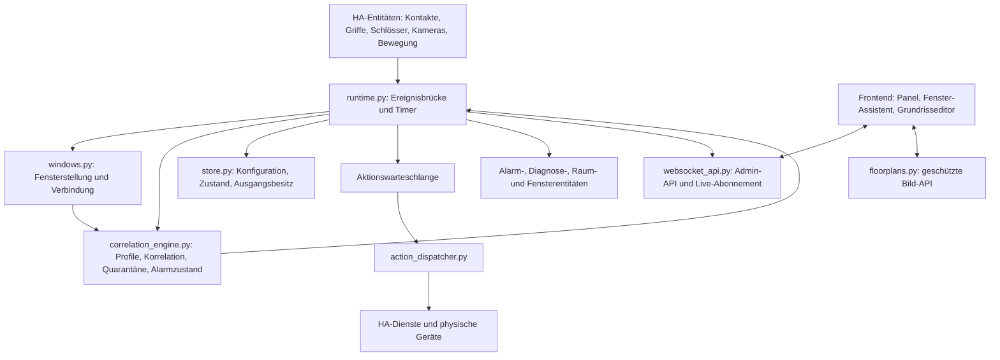

# IQAlarm – technischer Audit vom 18. Oktober 2026

**Geprüfter Stand:** Version 2.3.0, Commit `9aa27c0820e86f57cbae9a1a71eb89381afdbbab`, Branch `main`.

**Ergebnis:** 16 belegte Befunde: **2 KRITISCH, 5 HOCH, 9 MITTEL**. Hinzu kommen ausdrücklich getrennte Betriebsrisiken und Verbesserungsvorschläge. Die kritischen Befunde betreffen bestimmte Konfigurationen und Abläufe; daraus folgt nicht, dass jede bestehende Sensorzuordnung betroffen ist.

**Auftragsgrenze:** Es wurden keine Implementierungen, produktiven Konfigurationen, HA-Zustände oder Geräte verändert. Kein Deployment, Neustart, Commit oder Push wurde ausgeführt. Geschrieben wurden dieser Bericht sowie getrennte lokale Audit-Artefakte unter `.ha-test/audit-2026-10-18/`. Alle darin verwendeten Haus-, Geräte- und Sensordaten sind synthetisch.

**Fachliche Ergänzung vom 18. Oktober 2026:** Abschnitt 7 hält das vom Nutzer präzisierte Ziel einer räumlich und zeitlich plausiblen Alarmbewertung fest. Diese Anforderungen und Abnahmeszenarien ergänzen den Audit; sie sind noch nicht implementiert oder als neue Tests ausgeführt. Die Zahl der 16 nachgewiesenen Audit-Befunde bleibt unverändert.

## 1. Bestand und Architektur

Die Anwendung besteht aus einer lokalen Home-Assistant-Integration mit vier Entity-Plattformen und einem direkt ausführbaren Web-Component-Frontend. Es gibt keinen externen Anwendungsserver und keine relationale Datenbank. HA verwaltet Benutzer, Sitzungen, Geräte, Dienste und den Ereignisbus. IQAlarm speichert seine Konfiguration, den Engine-Zustand und die übernommenen Geräteausgänge gemeinsam über HA `Store`; Bilder liegen getrennt im HA-Konfigurationsverzeichnis.



### Tatsächlich geprüfte Bereiche

| Bereich | Komponenten und betrachtetes Verhalten |
| --- | --- |
| Start und Lebenszyklus | `__init__.py`, `config_flow.py`, `entity.py`, `compat.py`; Einrichtung, PIN, Registrierung, Entladen, Fehlerpfade |
| Fachmodell | `models.py`, `const.py`; Rollen, freie Profile/Stufen, Validierung, Migration, Referenzen, Fenstergruppen |
| Alarmbewertung | `correlation_engine.py`; Rohflanken, Debounce, Prellen, räumliche und zeitliche Bestätigung, Verzögerungen, Wiederherstellung |
| Laufzeit und Aktionen | `runtime.py`, `action_dispatcher.py`, `store.py`; Nebenläufigkeit, Persistierung, Generationen, Abschaltung, Kamera und Simulation |
| Native HA-Anbindung | `alarm_control_panel.py`, `binary_sensor.py`, `sensor.py`, `switch.py`; Verfügbarkeit, Zustände, dynamische Entitäten |
| APIs | alle 14 registrierten WS-Befehle, Bild-Upload/-Abruf, Kamera-Medienabruf, Admin-Service-Registrierung |
| Erkennung und Grundriss | `sensor_discovery.py`, `floorplan_analysis.py`, `floorplan_image.py`, `floorplans.py` |
| Oberfläche | alle vier ES-Module; Datenfluss, Formulare, Live-Status, Entwürfe, Fehleranzeigen, Import, Fenster-Assistent, Löschabläufe |
| Auslieferung und QA | Manifest, HACS-Metadaten, Übersetzungen, Services, Python-/Node-Konfiguration, CI-Workflow, Release-/Deploy-Skripte, vorhandene Testfälle und Integrationsprüfer |

Die Analyse verfolgt insbesondere diese vollständigen Abläufe: Sensorimport → gespeicherte Sensorregel → Rohwertnormalisierung → Korrelation; Fenster-Einlernen → Zuordnung → Gesamtstatus → Alarmquelle; Bestätigung → Persistierung → Aktionsausführung → Abschaltung; Entschärfen/Neustart → wiederhergestellter Zustand; parallele Browseränderungen → Revision → Speichern.

## 2. Priorisierte Befundliste

„Nachgewiesen“ bedeutet hier: Der konkrete Effekt wurde mit unveränderten Produktionsfunktionen oder im echten Chromium-Frontend mit isoliertem Testtransport reproduziert. Infrastrukturadapter ersetzen ausschließlich HA-Anbindung, Geräte, Uhr und Speicher. Diese Prüfungen sind kein erneuter Systemtest im echten HA Core.

| ID | Priorität | Beleg | Befund |
| --- | --- | --- | --- |
| IQ-001 | KRITISCH | Python | Griffbasierte Fenster können nach einer unklaren Zwischenkombination die tatsächliche Öffnung als bloße Wiederverfügbarkeit verlieren |
| IQ-002 | KRITISCH | Chromium + Python | Automatischer Import erzeugt für binäre Schlösser und direkte Kameraattribute unwirksame Aktivwerte |
| IQ-003 | HOCH | Python | Eine gehaltene bestätigte Stufe unterdrückt spätere höhere Gefahrenstufen |
| IQ-004 | HOCH | Python | Fensterzusammenführung ersetzt bestehende Schutzparameter durch feste Vorgaben |
| IQ-005 | HOCH | Python | Langsame Ausgangsabschaltungen verzögern Alarmtimer |
| IQ-006 | HOCH | Python | Langsame Licht-/Schaltaktionen blockieren den Start einer Vollalarmsirene |
| IQ-007 | HOCH | Chromium + Python | Der Import behandelt zwei Entitäten desselben Melders als unabhängige Bestätigung |
| IQ-008 | MITTEL | Python | Anwesenheitssimulation kann nach dem Entschärfen noch einen Einschaltbefehl senden |
| IQ-009 | MITTEL | Python | Ein vom Alarm übernommenes Simulationslicht behält seinen Simulationsbesitz und wird vorzeitig ausgeschaltet |
| IQ-010 | MITTEL | Python | Der angekündigte Rückfall auf Stufe 0 schaltet Ausgänge nicht automatisch ab |
| IQ-011 | MITTEL | Chromium | Abwählen eines Auslösers im Level-Formular hat keine Wirkung |
| IQ-012 | MITTEL | Chromium | Normale Sensorzeilen zeigen trotz Live-Verbindung veraltete Zustände |
| IQ-013 | MITTEL | Chromium + Codepfad | Grundrisslöschung kann vor einer nachfolgenden Validierung bereits dauerhaft erfolgt sein |
| IQ-014 | MITTEL | Python | Die Speicher-API akzeptiert widersprüchliche Fensterzuordnungen |
| IQ-015 | MITTEL | Python + UI-Code | Der Fenster-Assistent bietet textuelle Kontaktsensoren an, kann deren Offenwerte aber nicht einrichten |
| IQ-016 | MITTEL | Chromium | „90° Begradigen“ ersetzt bearbeitete Eckpunkte durch den alten gespeicherten Umriss |

### IQ-001 – Tatsächliche Fensteröffnung geht nach einer unklaren Zwischenstellung verloren

**Komponente:** Fenstererkennung und Engine. **Status: nachgewiesen.**

**Stellen:** [windows.py:33](X:/Entwicklungen/Alarmanlage/custom_components/iqalarm/windows.py:33), [runtime.py:100](X:/Entwicklungen/Alarmanlage/custom_components/iqalarm/runtime.py:100), [correlation_engine.py:313](X:/Entwicklungen/Alarmanlage/custom_components/iqalarm/correlation_engine.py:313).

**Bedingung und Reproduktion:** Ein Fenster wird ohne zusätzlichen physischen Kontakt aus zwei Griff-/Stellungssignalen erkannt. `off/off` ist geschlossen, `on/on` geöffnet. Beim Öffnen meldet Eingang A zuerst `on`, B folgt erst nach Ablauf der Stabilisierungszeit. Die stabile Zwischenkombination `on/off` ist nicht eingelernt und liefert `opening=None`, obwohl alle Eingänge erreichbar sind. Die Runtime reicht `None` an die Engine weiter. Das später korrekt erkannte `on/on` wird dort wegen `old is None` ausschließlich als Wiederverfügbarkeit behandelt. Auch eine unmittelbar anschließende Bewegung bestätigt im Nachtprofil nichts: Stufe 0 bleibt bestehen.

**Ursache und Wirkung:** Erreichbarkeit und fachlich unbestimmte Stellung teilen denselben Engine-Wert. Die Regel, nach einer Verbindungswiederkehr keine künstliche Einbruchsflanke zu erzeugen, verschluckt dadurch eine echte Öffnung. Fenster mit einem weiterhin verfügbaren separaten Kontakt haben diesen konkreten Fehlerpfad nicht.

**Empfehlung:** Verbindung, Stellungssicherheit und letzte gültige Öffnung getrennt führen. Bei durchgehend erreichbaren Quellen eine nachfolgende stabile Öffnung mit dem letzten bekannten geschlossenen Zustand vergleichen. Unklare Kombinationen als eigene Störung ausweisen; keine ungeprüfte `None → True`-Sonderregel als pauschale Lösung verwenden.

**Beleg:** `test_night_confirmation_can_be_lost_by_group_unknown_intermediate`.

### IQ-002 – Importierte Aktivwerte verhindern die Alarmauswertung

**Komponente:** Sensor-Erkennungs-Assistent und Normalisierung. **Status: nachgewiesen.**

**Stellen:** [iqalarm-panel.js:1703](X:/Entwicklungen/Alarmanlage/custom_components/iqalarm/frontend/iqalarm-panel.js:1703), [iqalarm-panel.js:1719](X:/Entwicklungen/Alarmanlage/custom_components/iqalarm/frontend/iqalarm-panel.js:1719), [runtime.py:57](X:/Entwicklungen/Alarmanlage/custom_components/iqalarm/runtime.py:57).

**Bedingung und Reproduktion:** Im tatsächlichen Browser-Assistenten einen `binary_sensor` mit Rolle `lock_contact` importieren. Er bekommt `active_states=["unlocked","open"]`. Sowohl sein realer Zustand `on` als auch `off` werden anschließend zu `False`. Der Schlosszustand wird damit weder als aktiv noch als Scharfschaltblocker erkannt. HA verwendet auch für binäre Schlosssensoren `on/off`; `on` bedeutet entriegelt. [Offizielle HA-Dokumentation](https://contributors.home-assistant.io/core/entities/binary-sensor/#device-classes).

Ein zweiter Zweig desselben Importfehlers betrifft direkte Kameras: Der Assistent setzt ungeprüft `attribute="person_detected"` und `active_states=["on"]`. Ein tatsächlich vorhandenes boolesches Attribut `True` normalisiert die Runtime aber zu `"true"`; die Person wird deshalb nicht erkannt. Fehlt das angenommene Attribut ganz, entsteht stattdessen dauerhafte Nichtverfügbarkeit.

**Ursache und Wirkung:** Die Rolle wird mit dem Rohdatenformat gleichgesetzt. Die gespeicherte Konfiguration ist syntaktisch gültig, fachlich aber unwirksam. Der Test importiert über die unveränderte UI und verwendet genau deren gespeicherte Konfiguration anschließend in der echten Normalisierungsfunktion.

**Empfehlung:** Standardwerte nach Domain und tatsächlichem Attributtyp bestimmen. Binäre Schlösser verwenden `on/off`, `lock.*` verwendet Schlosszustände. Kameras ohne nachgewiesenes Erkennungsattribut nicht als fertig eingerichteten Personensensor übernehmen. Vor Speichern eine sichtbare Live-Probe verlangen.

**Belege:** Browserfall `import`, exportierte `imported-config.json`, `test_imported_binary_lock_and_camera_true_never_become_active`.

### IQ-003 – Gehaltene Alarmstufe verhindert höhere Eskalation

**Komponente:** State Machine für freie Alarmstufen. **Status: nachgewiesen.**

**Stellen:** [correlation_engine.py:408](X:/Entwicklungen/Alarmanlage/custom_components/iqalarm/correlation_engine.py:408), [correlation_engine.py:497](X:/Entwicklungen/Alarmanlage/custom_components/iqalarm/correlation_engine.py:497).

**Reproduktion:** Zusätzlich zu Stufe 3 eine höhere bestätigte Stufe „Gefahr“ anlegen und `immediate` darauf abbilden. Fenster und Bewegung lösen zunächst die gehaltene Stufe 3 aus. Danach den Paniksensor aktivieren. Er wird nur als `signal` geloggt; Stufe 3 bleibt stehen und Aktionen der höheren Stufe starten nicht.

**Ursache und Wirkung:** `latched` beendet jede spätere Aktivierung vor der Prüfung auf Panik/Override. Auch `_set_level` blockiert bei `latched` jede Änderung. Das Halten einer Stufe bedeutet dadurch gleichzeitig das Sperren aller höheren Stufen.

**Empfehlung:** Halten als Untergrenze behandeln. Niedrigere Bewertung unterdrücken, höhere bestätigte Ziele und neue Gefahrenregeln dagegen zulassen und deren Aktionen eindeutig auslösen.

**Beleg:** `test_latched_lower_stage_suppresses_later_panic`.

### IQ-004 – Fensterzusammenführung verwirft zuvor konfigurierte Schutzparameter

**Komponente:** Virtuelle Alarmquelle eines Fensters. **Status: nachgewiesen.**

**Stellen:** [models.py:600](X:/Entwicklungen/Alarmanlage/custom_components/iqalarm/models.py:600), [correlation_engine.py:254](X:/Entwicklungen/Alarmanlage/custom_components/iqalarm/correlation_engine.py:254).

**Reproduktion:** Für einen Kontakt Override, Eingangsverzögerung, 250 ms Debounce und eine abweichende Prellschwelle konfigurieren. Den Kontakt anschließend zu einem Fenster zusammenführen. Die ursprüngliche Zuordnung bleibt gespeichert, wird aber von der Engine ausgeschlossen. Die neue synthetische Quelle erhält `immediate=False`, `debounce_ms=0`, Prellschwelle 3 und nur die im neuen Assistenten erneut gesetzte Eingangsverzögerung.

**Wirkung:** Ein zuvor ausdrücklich allein alarmberechtigter Kontakt erzeugt nur noch Verdacht. Bestehende Entprell- und Quarantänevorgaben wirken nicht mehr. Für mehrere verlorene Parameter bietet der Fenster-Assistent keinen Ersatz an; die eingerückten Quellen haben keinen normalen Bearbeitungsbutton mehr.

**Empfehlung:** Die wirksamen Schutzparameter am logischen Fenster vollständig modellieren. Bestehende Parameter bei der Zusammenführung übernehmen oder konkrete Abweichungen vor dem Speichern ausdrücklich bearbeiten lassen. Die persistierte Altzuordnung darf keinen weiter wirksamen Schutz vortäuschen.

**Beleg:** `test_window_merge_overwrites_original_protection_settings`.

### IQ-005 – Geräteabschaltung blockiert Alarmtimer

**Komponente:** Runtime-Takt und Ausgangsbereinigung. **Status: nachgewiesen.**

**Stellen:** [runtime.py:143](X:/Entwicklungen/Alarmanlage/custom_components/iqalarm/runtime.py:143), [runtime.py:155](X:/Entwicklungen/Alarmanlage/custom_components/iqalarm/runtime.py:155), [action_dispatcher.py:279](X:/Entwicklungen/Alarmanlage/custom_components/iqalarm/action_dispatcher.py:279).

**Reproduktion:** Ein bestätigter Eintritt wartet bis Zeitpunkt 104 auf seine Eingangsverzögerung. Der Tick bei 103 beginnt die Abschaltung eines zuvor übernommenen Lichts und wartet auf dessen Antwort. Ein weiterer Tick bei 110 kehrt wegen `_timer_running` sofort zurück. Der Alarm bleibt weiterhin `pending`, bis die Geräteoperation beendet ist und ein neuer Tick stattfindet.

**Ursache und Wirkung:** Sicherheitsrelevante Timer, Simulation, Dateibereinigung und externe Geräteaufrufe teilen denselben gegen Wiedereintritt gesperrten Ablauf. Jeder Service kann bis zu 30 Sekunden warten; mehrere Ausgänge werden seriell bereinigt. Auch Debounce und der Ablauf einer Ausgangsverzögerung sind betroffen. Direkte Sensorflanken werden weiterhin verarbeitet; der Fehler betrifft die davon abhängigen Timer.

**Empfehlung:** Die deterministische Timerfortschreibung ohne externe I/O ausführen. Simulation, Dateien und Abschaltungen in getrennte, begrenzte Hintergrundaufgaben mit eigenen Fehlerzuständen verschieben.

**Beleg:** `test_pending_alarm_timer_is_blocked_by_output_shutdown`; kontrollierte Uhr und blockierende lokale Serviceantwort, kein reales Gerät.

### IQ-006 – Niedrige Lichtaktion blockiert den Sirenenstart

**Komponente:** Aktionsparallelität. **Status: nachgewiesen.**

**Stellen:** [action_dispatcher.py:169](X:/Entwicklungen/Alarmanlage/custom_components/iqalarm/action_dispatcher.py:169), [action_dispatcher.py:240](X:/Entwicklungen/Alarmanlage/custom_components/iqalarm/action_dispatcher.py:240).

**Reproduktion:** Eine Verdachtsaktion schaltet ein Licht und wartet auf dessen Rückmeldung. Währenddessen einen bestätigten Vollalarm mit Sirenenaktion verarbeiten. Der Sirenendienst wird erst aufgerufen, nachdem der Lichtdienst freigegeben wurde.

**Ursache und Wirkung:** Sirene, Schalter, Licht und Skript halten denselben globalen Dispatcher-Lock über Persistierung und komplette Serviceausführung. Die Prioritätssortierung wirkt nur innerhalb eines einzelnen Ereignisses und unterbricht die frühere Aktion nicht. Der vorhandene Integrationstest mit langsamer Push-Nachricht deckt diesen Fehler nicht ab, weil Push diesen Lock nicht hält.

**Empfehlung:** Besitzänderungen kurz serialisieren und Geräte getrennt koordinieren. Für unabhängige Alarmgeräte darf eine langsame Licht- oder Skriptantwort kein Hindernis sein. Eskalationspriorität über Ereignisse hinweg prüfen.

**Beleg:** `test_slow_low_stage_light_blocks_full_alarm_siren`.

### IQ-007 – Derselbe Melder kann sich nach dem Import selbst bestätigen

**Komponente:** Geräteerkennung und Identität der Alarmquelle. **Status: nachgewiesen.**

**Stellen:** [sensor_discovery.py:410](X:/Entwicklungen/Alarmanlage/custom_components/iqalarm/sensor_discovery.py:410), [iqalarm-panel.js:1711](X:/Entwicklungen/Alarmanlage/custom_components/iqalarm/frontend/iqalarm-panel.js:1711), [correlation_engine.py:429](X:/Entwicklungen/Alarmanlage/custom_components/iqalarm/correlation_engine.py:429).

**Reproduktion:** Ein Gerät liefert Bewegung und Präsenz über zwei binäre Entitäten. Die Erkennung kennt für beide dieselbe `device_id`. Der Browserimport setzt trotzdem für jede Entität die eigene Entity-ID als `source_id`. Aktivieren beide Ausgänge desselben Geräts im Abwesenheitsprofil, bestätigt die Engine einen Einbruch.

**Ursache und Wirkung:** Die Engine schützt korrekt vor identischen Quellenkennungen. Der Import stellt diese Kennungen jedoch nicht aus der bereits bekannten Gerätezugehörigkeit her. Eine einzelne physische Messung kann dadurch die behauptete unabhängige Kreuzbestätigung erfüllen.

**Empfehlung:** Gerätezugehörigkeit als Vorschlag für physische Quellen verwenden und im Assistenten zusammengehörige Ausgänge sichtbar gruppieren. Sammelgeräte/Hubs benötigen eine explizite Ausnahme, weil eine gemeinsame Device-ID nicht immer eine gemeinsame physische Messquelle bedeutet.

**Belege:** Browserfall `import` mit gleicher `device_id`; `test_household_detector_siblings_with_imported_source_ids_self_confirm` verwendet den tatsächlichen Browserexport.

### IQ-008 – Simulation sendet nach dem Entschärfen noch Einschaltbefehle

**Komponente:** Anwesenheitssimulation. **Status: nachgewiesen.**

**Stelle:** [action_dispatcher.py:316](X:/Entwicklungen/Alarmanlage/custom_components/iqalarm/action_dispatcher.py:316).

**Reproduktion:** Die Simulation besteht die Prüfung der aktuellen Generation, übernimmt ein Licht und wartet auf `_persist_outputs()`. Während dieser Wartezeit wird entschärft und die Generation erhöht. Nach Fortsetzung ruft die Simulation trotzdem `light.turn_on` auf.

**Ursache und Wirkung:** Nach einem `await` fehlt die erneute Freigabeprüfung. Anders als gewöhnliche Geräteaktionen übergibt die Simulation der abschließenden `_call`-Funktion keine Generation. Das Licht kann nach dem Ausschalten der Anlage noch angehen; eine spätere Bereinigung kann es wieder ausschalten.

**Empfehlung:** Generation bis zum tatsächlichen Serviceaufruf durchreichen und nach jeder asynchronen Unterbrechung prüfen. Bei abgebrochener Übernahme den Ausgangsbesitz bereinigen.

**Beleg:** `test_simulation_starts_light_after_disarming_during_persistence`.

### IQ-009 – Alarmlicht bleibt fälschlich ein Simulationsausgang

**Komponente:** Gemeinsame Ausgangsverwaltung von Alarm und Simulation. **Status: nachgewiesen.**

**Stellen:** [action_dispatcher.py:257](X:/Entwicklungen/Alarmanlage/custom_components/iqalarm/action_dispatcher.py:257), [action_dispatcher.py:304](X:/Entwicklungen/Alarmanlage/custom_components/iqalarm/action_dispatcher.py:304).

**Reproduktion:** Ein Simulationslicht ist an. Eine Alarmaktion verwendet dasselbe Licht und verlängert seine Laufzeit. Das vorhandene `simulation=True` und die Mitgliedschaft in `simulation_outputs` bleiben erhalten. Wird anschließend die Simulation deaktiviert oder endet ihr Zeitfenster, wird der Ausgang auf Ablaufzeit 0 gesetzt und abgeschaltet, obwohl die Alarmaktion noch laufen sollte.

**Empfehlung:** Mehrere Besitzer beziehungsweise Gründe und deren Fristen getrennt führen. Das Beenden der Simulation darf einen noch vom Alarm benötigten Ausgang nicht freigeben.

**Beleg:** `test_disabling_simulation_can_stop_light_reused_by_alarm`.

### IQ-010 – Rückfall auf Stufe 0 stoppt Ausgänge nicht wie angekündigt

**Komponente:** Stufenablauf und Ausgangsverwaltung. **Status: nachgewiesen.**

**Stellen:** [iqalarm-panel.js:355](X:/Entwicklungen/Alarmanlage/custom_components/iqalarm/frontend/iqalarm-panel.js:355), [runtime.py:211](X:/Entwicklungen/Alarmanlage/custom_components/iqalarm/runtime.py:211), [runtime.py:155](X:/Entwicklungen/Alarmanlage/custom_components/iqalarm/runtime.py:155).

**Reproduktion:** Bei einer nicht gehaltenen bestätigten Stufe eine Sirene mit langer Aktionsdauer aktivieren. Die Bestätigung und alle Belege ablaufen lassen. Die Engine meldet Stufe 0, die Sirene bleibt bis zum eigenen Ausgangstimer eingeschaltet.

**Ursache und Wirkung:** Das Level-Formular verspricht bei Stufe 0 eine automatische Abschaltung. Die Runtime bereinigt aber nur nach Ausgangsfrist, Entschärfung oder Stopp. Ein `level_expired` auf 0 löst keine besondere Abschaltung aus. Anzeige und tatsächlich weiterlaufende Reaktion können dadurch auseinanderfallen.

**Empfehlung:** Die gewünschte Lebensdauer je Aktion eindeutig definieren und die Oberfläche daran ausrichten. Soll die beschriebene Abschaltung gelten, diese bei Stufe 0 gezielt für Alarmbesitz ausführen; Simulationsbesitz getrennt behandeln.

**Beleg:** `test_return_to_zero_does_not_stop_alarm_outputs`.

### IQ-011 – Auslöser-Checkbox lässt sich scheinbar abwählen

**Komponente:** Level-Konfiguration. **Status: nachgewiesen.**

**Stelle:** [iqalarm-panel.js:1650](X:/Entwicklungen/Alarmanlage/custom_components/iqalarm/frontend/iqalarm-panel.js:1650).

**Reproduktion:** Unter einer Stufe „Öffnung + Bewegung“ abwählen und „Level speichern“ drücken. Der gespeicherte Zielwert bleibt unverändert; nach dem Rendern erscheint der Haken wieder.

**Ursache und Wirkung:** Beim Speichern werden nur aktiv gesetzte Checkboxen übernommen. Abgewählte Regeln werden weder umgestellt noch deaktiviert. „Gespeichert“ signalisiert eine Änderung, die nicht erfolgt ist. Die eigentlichen Profilregeln können weiterhin wie zuvor auslösen.

**Empfehlung:** Für abgewählte Regeln eine explizite neue Zuordnung beziehungsweise Deaktivierung verlangen, oder das Formular als eindeutige Zielauswahl gestalten. Eine nicht ausgeführte Änderung darf keine Erfolgsmeldung bekommen.

**Beleg:** Browserfall `rule-uncheck`: vorher `true`, gespeichertes Ziel weiterhin `3`, nachher wieder `true`.

### IQ-012 – Sensorliste bleibt trotz Live-Meldung veraltet

**Komponente:** Frontend-Zustand und DOM-Aktualisierung. **Status: nachgewiesen.**

**Stellen:** [iqalarm-panel.js:165](X:/Entwicklungen/Alarmanlage/custom_components/iqalarm/frontend/iqalarm-panel.js:165), [iqalarm-panel.js:205](X:/Entwicklungen/Alarmanlage/custom_components/iqalarm/frontend/iqalarm-panel.js:205).

**Reproduktion:** Auf „Kameras & Sensoren“ einen normalen Bewegungsmelder beobachten. Der Live-Push ändert dessen Rohwert von `False` auf `True`. `panel.data` enthält schon den richtigen Wert, die Tabellenzeile zeigt weiterhin „Ruhig“. Erst erneutes Rendern zeigt „Aktiv“.

**Ursache und Wirkung:** Außerhalb von Dashboard und Logbuch wird nur die Schreibsperre aktualisiert. Für Fenstergruppen gibt es einen Sonderfall, für normale Sensorzeilen keinen. Auch ein Raum-Live-Dialog in einem nicht regelmäßig gerenderten Tab kann deshalb veralten. Der Verbindungsindikator bleibt dabei grün.

**Empfehlung:** Statusfelder unabhängig von bearbeitbaren Formularen aktualisieren. Sensorzeilen und offene Live-Dialoge an denselben Snapshot binden, ohne Eingaben durch vollständiges Neurendern zu verlieren.

**Beleg:** Browserfall `stale-sensor-row`: `Ruhig → Ruhig`, gespeicherter Rohwert `true`, nach Rendern `Aktiv`.

### IQ-013 – Grundrisslöschung ist nicht atomar

**Komponente:** Grundriss löschen und zugehörige Räume zurücksetzen. **Status: nachgewiesen für den Browserablauf; Dauerhaftigkeit folgt aus dem geprüften Backendpfad.**

**Stellen:** [iqalarm-panel.js:1763](X:/Entwicklungen/Alarmanlage/custom_components/iqalarm/frontend/iqalarm-panel.js:1763), [iqalarm-panel.js:1615](X:/Entwicklungen/Alarmanlage/custom_components/iqalarm/frontend/iqalarm-panel.js:1615), [runtime.py:343](X:/Entwicklungen/Alarmanlage/custom_components/iqalarm/runtime.py:343).

**Reproduktion:** Einen Grundriss mit einem Raum und einem zusammengeführten Fenster löschen; „Auch angelegte IQAlarm-Räume zurücksetzen“ bleibt wie vorgegeben ausgewählt. Zuerst wird die Grundrisslöschung erfolgreich per CRUD gespeichert. Erst danach prüft `_pruneRooms`, ob Fenster die Raumlöschung verhindern, und wirft einen Fehler. Der Dialog meldet Scheitern, der Grundriss ist bereits entfernt.

**Wirkung:** Eine Fehleranzeige bedeutet hier nicht, dass der Zustand unverändert blieb. Beim realen Backend entfernt die erste Speicherung zusätzlich das nicht mehr referenzierte Bild. Der zweite Schritt kann außerdem an einem zwischenzeitlichen Revisionskonflikt scheitern.

**Empfehlung:** Beide Änderungen und alle Referenzprüfungen als eine Konfigurationstransaktion behandeln. Erst nach erfolgreicher Gesamtvalidierung speichern und verwaiste Bilder entfernen. Abhängigkeiten vor der destruktiven Operation anzeigen.

**Beleg:** Browserfall `partial-floorplan-delete`: Grundriss fehlt, Raum bleibt, Fehlermeldung fordert vorheriges Entfernen der Fenster. Der Transport ist lokal; keine persönlichen Grundrisse wurden gelöscht.

### IQ-014 – Speicherprüfung akzeptiert widersprüchliche Fensterstellungen

**Komponente:** Serverseitige Konfigurationsvalidierung. **Status: nachgewiesen.**

**Stellen:** [models.py:255](X:/Entwicklungen/Alarmanlage/custom_components/iqalarm/models.py:255), [models.py:658](X:/Entwicklungen/Alarmanlage/custom_components/iqalarm/models.py:658), [windows.py:29](X:/Entwicklungen/Alarmanlage/custom_components/iqalarm/windows.py:29).

**Reproduktion:** Über das Konfigurationsmodell ein Fenster speichern, bei dem der physische Kontakt `on` als „geschlossen“ eingetragen ist. Die vollständige `Configuration.from_dict`-Validierung akzeptiert es. Die Erkennung liefert anschließend gleichzeitig `state="closed"` und `opening=True`. Ebenso genügt serverseitig eine einzelne gelernte Stellung, obwohl der Assistent geschlossen und offen verlangt.

**Ursache und Wirkung:** Die Kontaktkonsistenz wird nur beim Capture-Befehl geprüft. Der eigentliche Speicherpfad vertraut den übergebenen Zuordnungen. Ein fehlerhafter API-Client, eine manuell übernommene Konfiguration oder eine spätere UI-Regression kann widersprüchliche Anzeigen und Alarmquellen dauerhaft speichern. Die API ist adminpflichtig; dies ist keine nachgewiesene Umgehung von Benutzerrechten.

**Empfehlung:** Dieselben fachlichen Invarianten beim endgültigen Speichern prüfen: erforderliche Stellungen, Kontakt-Offenwerte, korrekte physische Interpretation und eindeutige Zuordnungen.

**Beleg:** `test_mismatched_contact_mapping_is_accepted_by_save_model`.

### IQ-015 – Angebotene textuelle Fensterkontakte lassen sich nicht korrekt einlernen

**Komponente:** Eingangsformat des Fenster-Assistenten. **Status: nachgewiesen.**

**Stellen:** [window-assistant.js:44](X:/Entwicklungen/Alarmanlage/custom_components/iqalarm/frontend/window-assistant.js:44), [window-assistant.js:62](X:/Entwicklungen/Alarmanlage/custom_components/iqalarm/frontend/window-assistant.js:62), [windows.py:82](X:/Entwicklungen/Alarmanlage/custom_components/iqalarm/windows.py:82).

**Reproduktion:** Als Fensterkontakt eine angebotene `sensor.*`-Entität auswählen, die `closed/open` meldet. Der Assistent konfiguriert ausschließlich `contact_open_states=["on"]` oder invertiert `["off"]`. Bei tatsächlichem `open` lehnt die Capture-Funktion den Schritt als unpassenden Kontakt ab. Eine über die API hinterlegte Open-Zuordnung kann sogar als Position „Offen“ und Öffnungswert `False` gleichzeitig erscheinen.

**Empfehlung:** Entweder die Auswahl auf tatsächlich unterstützte binäre Kontakte beschränken oder Offen-/Geschlossenwerte für Enum-/Textkontakte im Assistenten konfigurierbar machen und live verifizieren. Nicht bekannte Rohwerte müssen ausdrücklich unbestimmt bleiben.

**Beleg:** `test_valid_contact_makes_unmapped_text_states_false_safe` einschließlich Capture-Ablehnung.

### IQ-016 – Begradigen verwirft den aktuellen Grundrissentwurf

**Komponente:** Grundrisseditor und Entwurfssicherung. **Status: nachgewiesen.**

**Stelle:** [iqalarm-panel.js:1524](X:/Entwicklungen/Alarmanlage/custom_components/iqalarm/frontend/iqalarm-panel.js:1524).

**Reproduktion:** Einen bereits gespeicherten Raum auswählen und seine Eckpunkte bearbeiten. Im Test wird die rechte Wand von x=0,4 auf x=0,8 verschoben. Danach „90° Begradigen“ drücken. Die Funktion begradigt zunächst die alten gespeicherten Zonen, speichert diese und ersetzt anschließend die aktuellen Punkte durch die gespeicherte Zone. Die rechte Wand steht wieder bei x=0,4; der Entwurf wird als gespeichert markiert.

**Ursache und Wirkung:** Bei einem bestehenden `zoneRoom` haben die alten gespeicherten Zonen Vorrang vor den bearbeiteten `points`. Der aktive Entwurf wird beim Vorbereiten der Speicherung nicht in die Zonen eingesetzt. Danach setzt `markSaved` den falschen Umriss als neue Basis. Die Bearbeitung verschwindet aus der aktiven Fläche und erhält keinen Hinweis auf den Verlust. Eine vorhandene Undo-Historie kann unter Umständen helfen, ändert aber nichts an der unbeabsichtigten Ersetzung.

**Empfehlung:** Zunächst den aktiven Entwurf begradigen. Einträge erst beim vorgesehenen Speicherschritt übernehmen oder die beabsichtigte Sammeländerung eindeutig bestätigen lassen. `markSaved` ausschließlich nach Speicherung genau der angezeigten Geometrie aufrufen.

**Beleg:** Browserfall `orthogonalize-loses-draft`: x=0,8 wird wieder x=0,4, anschließend `dirty=false`.

## 3. Bewusst getrennte Betriebsrisiken und Grenzen

Diese Punkte sind keine zusätzlichen bestätigten Implementierungsfehler und werden nicht in die 16 Befunde eingerechnet.

### R-001 – Quarantäne aus dem unscharfen Betrieb bleibt beim Scharfschalten erhalten

**Beobachtet, fachliche Entscheidung offen.** [correlation_engine.py:336](X:/Entwicklungen/Alarmanlage/custom_components/iqalarm/correlation_engine.py:336) führt bei aktivierter Diagnose auch unscharf die Prell-Erkennung aus. Drei normale Kontaktwechsel in 15 Sekunden können Quarantäne erzeugen. Das Scharfschalten übernimmt sie; `arm_blockers()` überspringt quarantänisierte Kontakte. Dadurch kann ein gerade offener, ausgeschlossener Kontakt die Scharfschaltung nicht verhindern. Die Quarantäne wird sichtbar angezeigt. Ein automatisches Löschen bei jeder Scharfschaltung würde allerdings einen wirklich defekten Kontakt wieder aktivieren und ist deshalb keine pauschal richtige Korrektur.

**Zu entscheiden:** Diagnoseunsicherheit, bewusstes Überbrücken und Freigabe einer ausgeschlossenen Zone ausdrücklich unterscheiden; gegebenenfalls eine sichtbare Bestätigung zum Scharfschalten mit ausgeschlossenen Kontakten vorsehen. Beleg: `test_ordinary_disarmed_contact_cycles_isolate_next_armed_session`.

### R-002 – Nach Ablauf des Verdachtsfensters bleibt ein offenes Fenster ohne neue Flanke unbeachtet

**Nachgewiesenes Verhalten entsprechend dem derzeit beschriebenen Zeitmodell.** Ein Fenster bleibt offen; nach Ablauf des Korrelationsfensters sinkt die Stufe auf 0. Eine erst danach auftretende Bewegung wird bei `after_contact` ignoriert. Ein anhaltend offener Kontakt erneuert die Freigabe nicht. Das entspricht dem dokumentierten Rückfall nach unbestätigtem Einzelereignis, schafft aber ein zeitliches Angriffsfenster.

**Zu entscheiden:** Ob ein weiterhin offener Kontakt in bestimmten Profilen eine anhaltende Nacht-Bewegungsfreigabe oder eine gesonderte offene Zone bewirken soll. Keine Änderung ohne diese fachliche Festlegung. Beleg: `test_suspicion_after_contact_expiry_keeps_night_motion_disarmed`.

### R-003 – Neustart erhält die Alarmanzeige, setzt abgeschaltete Sirenen aber nicht wieder in Betrieb

**Nachgewiesene und derzeit ausdrücklich vorgesehene Wiederanlaufpolitik.** [runtime.py:187](X:/Entwicklungen/Alarmanlage/custom_components/iqalarm/runtime.py:187) schaltet übernommene Ausgänge beim sauberen Stopp ab. Der gehaltene Alarm wird gespeichert und wiederhergestellt; frühere Aktionen werden absichtlich nicht wiederholt. Ergebnis nach Reload/Neustart: bestätigter Alarm kann angezeigt werden, während die Sirene aus bleibt.

**Zu entscheiden:** Zwischen einmaligen Pushs und zustandsgebundenen Alarmgeräten unterscheiden. Eine Wiederanlaufpolitik könnte nur noch erforderliche Ausgänge mit begrenzter Restlaufzeit wiederherstellen. Ein pauschales Replay aller Aktionen wäre ebenfalls problematisch. Beleg: `test_documented_shutdown_restores_alarm_state_without_siren_restart`.

### R-004 – Aktionsüberlastung ist nur teilweise begrenzt

**Potenzielles Stabilitätsrisiko, kein Lasttest mit nachgewiesenem Absturz.** [runtime.py:249](X:/Entwicklungen/Alarmanlage/custom_components/iqalarm/runtime.py:249) begrenzt laufende Aktionsaufgaben nur bei unbestätigten Ereignissen. Bestätigte Ereignisse umgehen die Grenze 32. Gleichzeitig kann die Warteschlange Ereignisse bei Füllstand 200 verwerfen. Bei speziellen nicht gehaltenen Stufen und sehr vielen wechselnden Quellen kann die Last deshalb anders ausfallen als in der Standardkonfiguration.

**Empfehlung:** Reservierte Kapazität für bestätigte Alarme, globale und gerätebezogene Ausführungsgrenzen sowie kontrolliertes Zusammenfassen veralteter Aktionen unter Last prüfen. Häufigkeit und tatsächliche Auswirkung wurden nicht im Produktivsystem gemessen.

### R-005 – Speichergeschwindigkeit liegt im Pfad bis zur Geräteaktion

**Architekturrisiko.** [runtime.py:201](X:/Entwicklungen/Alarmanlage/custom_components/iqalarm/runtime.py:201) wartet auf Persistierung, bevor Aktionen in die Queue gelangen. Ein Schreibfehler wird behandelt, ein sehr langsamer oder hängender Speicherzugriff hat hier aber keine explizite Zeitgrenze. Die Reihenfolge schützt die Wiederherstellbarkeit; sie koppelt zugleich die Reaktionszeit an den Speicher.

**Empfehlung:** Die gewünschte Priorität zwischen sofortiger Reaktion, dauerhaftem Alarmzustand und sicherem Ausgangsbesitz festlegen und anschließend mit blockierten Schreibzugriffen in einem echten Test-Core prüfen. Es wurde kein Festplattenausfall an der laufenden Anlage simuliert.

## 4. Sicherheit, Abhängigkeiten und Qualitätsbewertung

### Zutreffende Schutzmaßnahmen im geprüften Code

- Alle registrierten IQAlarm-WebSocket-Befehle verlangen einen HA-Administrator. Die eigenen Services werden als Admin-Services registriert. Es wurde in diesen geprüften Einstiegspunkten keine fehlende Admin-Prüfung gefunden.
- Bild-Upload und Grundrissabruf verlangen Authentifizierung und Adminrechte. Bildnamen sind restriktiv validiert; Bilddekodierung begrenzt Dateigröße und Pixelzahl und schreibt bereinigte PNG-Pixel. Grundrisse werden nicht an einen KI- oder Cloud-Dienst übertragen.
- Kameramedien liegen außerhalb von `/local`. Abrufe sind authentifiziert; für Nichtadministratoren werden die Leserechte der zugehörigen Kamera geprüft. Geheime Werte werden nicht an das Panel übergeben.
- Die optionale PIN wird gesalzen mit PBKDF2-HMAC gespeichert und konstantzeitlich verglichen. Der Eingabepfad serialisiert Prüfungen und begrenzt Fehlversuche. Das Audit hat keine PIN- oder Zugangsdaten ausgelesen.
- Der normale Konfigurationspfad verwendet eine Sperre und Konfigurationsrevisionen und verbietet Änderungen bei aktiven Reaktionen. Unbekannte Modellfelder werden zurückgewiesen. Das schützt vor vielen stillen Konfigurationsfehlern, ersetzt aber die in IQ-014 fehlenden fachlichen Invarianten nicht.
- Nutzertexte werden in den geprüften HTML-Erzeugungen überwiegend zentral maskiert beziehungsweise per `textContent` gesetzt. Es wurde kein belastbarer Injection- oder XSS-Befund in den untersuchten Datenflüssen nachgewiesen.

Diese Aussagen sind Ergebnisse des Quellcode-Audits. Sie sind kein separater Penetrationstest gegen alle HA-Endpunkte oder eine Garantie für die Sicherheit von HA, HACS, Kameras oder Drittintegrationen.

### Abhängigkeiten und Auslieferung

Das Produktionsfrontend lädt lokale ES-Module ohne CDN oder Node-Build auf HA. Das Manifest hat keine zusätzlich nachzuladenden Python-Requirements; die Integration verwendet HA-APIs und die in der HA-Umgebung vorhandenen Bibliotheken, darunter Pillow. Die Node-Abhängigkeiten dienen den Entwicklungstests.

`npm audit --json` meldete bei dieser Prüfung **0 bekannte Schwachstellen** für den vorhandenen Lockfile-Stand. Für die Python-/HA-Gesamtumgebung wurde kein vollständiger versionsgebundener CVE-Abgleich ausgeführt. Aus dem Node-Ergebnis folgt keine Aussage über die HA-Laufzeit oder installierte Drittintegrationen.

Release-Paketierung ist reproduzierbar und die lokalen Deploy-Funktionen besitzen Pfadprüfungen und Rollbacktests. Der reale SSH-Transport und ein unterbrochenes Deployment wurden in diesem Audit nicht ausgeführt. Der separate Browser-Testserver stellt absichtlich eine Testsitzung bereit; er gehört nicht zum Integrationspaket und muss wie dokumentiert auf localhost beziehungsweise einen isolierten Testcontainer begrenzt bleiben.

### Verbesserungen ohne eigenen Fehlerstatus

1. **Gezielte Ereignisabonnements und kleinere Live-Pakete.** Die Runtime beobachtet den globalen `state_changed`-Bus und publiziert vollständige Konfiguration und Status. Bei vielen Fenstern/Abonnenten entstehen wiederholte Ableitungen und Serialisierung. HA bietet dafür [gezielte State-Change-Helfer](https://contributors.home-assistant.io/core/integrations/events/#state-changes). Ohne Lastmessung ist dies eine Optimierungsempfehlung, kein belegter Performanceausfall.
2. **Eine zentrale Quelle für Einrichtungsregeln.** Sensorimport, manueller Editor, Fenster-Assistent und Servermodelle bestimmen teilweise dieselbe Fachlogik getrennt. Die belegten Format- und Validierungsfehler zeigen, wo diese Trennung bereits Inkonsistenzen erzeugt. Gemeinsame serverseitige Fähigkeiten/Validierung sollten die Korrekturen tragen.
3. **Lebenszyklus- und Konkurrenztests ausbauen.** Priorität haben die konkret reproduzierten Fehler. Weitere Tests sollten mehrere Browser, nachträgliche Sensorverfügbarkeit, langsame Geräte, Aktionsbesitz und Alarmfortsetzung nach Neustart kombinieren. Eine pauschale Neuschreibung oder bloße Umformatierung ist dafür nicht erforderlich.

## 5. Verifikation, Reproduzierbarkeit und offene Prüfbereiche

| Prüfung | Ergebnis dieses Audits |
| --- | --- |
| Vorhandene Python-Suite | 202 Tests bestanden |
| Ruff-Lint und Formatprüfung | bestanden; 40 Python-Dateien bereits formatiert |
| Vorhandene JavaScript-Unit-Tests | 22 Tests bestanden |
| Syntax Panel und Fenster-Assistent | bestanden |
| Zusätzliche Python-Gegenproben | 16 bestanden: 12 reproduzieren Befunde, 3 dokumentieren Betriebsentscheidungen, 1 prüft kontrolliert die spätere Abschaltung eines bereits laufenden Gerätebefehls |
| Zusätzliche Chromium-Gegenproben | 5 bestanden: echter UI-Import, Regel-Abwahl, veralteter Sensorstatus, teilweise erfolgte Grundrisslöschung, verlorener Entwurf beim Begradigen; isolierter lokaler Transport |
| Node-Abhängigkeitsprüfung | `npm audit`: 0 bekannte Schwachstellen |
| Echter HA-Core-/21-Fälle-Browser-Systemtest | **nicht erneut ausgeführt**: lokaler Docker-Daemon nicht erreichbar und HA-Pythonpaket lokal nicht installiert |
| Produktive Sirenen, Kameras, Push-Zustellung und Funkgeräte | **nicht aktiv getestet**; entsprechend dem Audit-Auftrag keine produktiven Aktionen |
| Vollständiger Python-/HA-CVE-Abgleich, Last-/Dauertest, dynamischer Rechte-Penetrationstest | **nicht durchgeführt** |

Die bestehenden Prüfer und deren dokumentierte frühere HA-/CI-Prüfungen wurden gelesen. Ein grüner früherer CI-Lauf wird hier nicht als aktueller vollständiger Systemtest ausgegeben. Die vorhandene lokale Python-Suite erreicht gerundet **50 % Zeilenabdeckung der Integration**, darunter 96 % der Engine und 94 % der Fenstererkennung. HA-abhängige Module wie Runtime, Dispatcher und WS-API werden von dieser lokalen Suite nicht ausgeführt; dafür existieren die separaten HA-Prüfer. Die Audit-Gegenproben prüfen ausgewählte Funktionskörper dieser Module zusätzlich über den beschriebenen Infrastrukturadapter. Diese Abdeckungswerte ersetzen keine HA-Systemtests.

**Interpretation der Gegenproben:** Ihre Assertions erwarten den im Bericht beschriebenen fehlerhaften Ist-Zustand. Ein grüner Audit-Test bedeutet deshalb „Fehler reproduziert“ und nicht „Anwendung korrekt“. Drei weitere Tests dokumentieren die bewusst getrennten Betriebsrisiken R-001 bis R-003. Der Test zu einem bereits gestarteten Gerätebefehl bestätigt, dass eine nachfolgende Bereinigung ihn wieder abschaltet; daraus wurde kein zusätzlicher Fehler konstruiert.

Die Backend-Gegenproben laden die geprüften Funktionskörper direkt aus dem unveränderten Quellcode. Der lokale Adapter ersetzt HA-Imports, Speicher und Service-Registry. Die Browser-Gegenproben laden die unveränderten Frontendmodule in Chromium und speichern nur synthetische Daten im lokalen Testtransport. Insbesondere wurden keine echten Sensoren umgeschaltet und keine Hausgrundrisse verwendet.

### Lokale Artefakte

- [Python-Gegenproben](X:/Entwicklungen/Alarmanlage/.ha-test/audit-2026-10-18/test_reproductions.py)
- [Infrastrukturadapter mit dokumentierter Grenze](X:/Entwicklungen/Alarmanlage/.ha-test/audit-2026-10-18/audit_support.py)
- [Chromium-Gegenproben](X:/Entwicklungen/Alarmanlage/.ha-test/audit-2026-10-18/browser_reproductions.mjs)
- [Browserergebnisse](X:/Entwicklungen/Alarmanlage/.ha-test/audit-2026-10-18/browser-results.json)
- [Vom echten UI-Import erzeugte synthetische Konfiguration](X:/Entwicklungen/Alarmanlage/.ha-test/audit-2026-10-18/imported-config.json)
- [JUnit-Protokoll](X:/Entwicklungen/Alarmanlage/.ha-test/audit-2026-10-18/reproductions.xml)
- [Abdeckung der vorhandenen lokalen Python-Tests](X:/Entwicklungen/Alarmanlage/.ha-test/audit-2026-10-18/coverage.json)
- [Prüfsummen des geprüften Quellstands](X:/Entwicklungen/Alarmanlage/.ha-test/audit-2026-10-18/source-sha256.json)
- [Reproduktionspaket als ZIP](X:/Entwicklungen/Alarmanlage/.ha-test/audit-2026-10-18/reproductions.zip)

Reproduktion im Projektverzeichnis, mit den vorhandenen Testabhängigkeiten und lokalem Chromium:

```powershell
python -X utf8 .ha-test/audit-2026-10-18/make_fixture.py
node .ha-test/audit-2026-10-18/browser_reproductions.mjs
python -X utf8 -m pytest .ha-test/audit-2026-10-18/test_reproductions.py -q
```

Das Browserskript verwendet den aktuell vorhandenen lokalen Chromium-Pfad. Bei einer anderen Playwright-Installation muss ausschließlich dieser Pfad im Audit-Skript angepasst werden. Die Reihenfolge erzeugt zuerst den für zwei Python-Nachweise verwendeten tatsächlichen UI-Import.

## 6. Empfohlene Korrekturreihenfolge

Für die spätere Umsetzung gilt das in Abschnitt 7 präzisierte Zielmodell. Insbesondere darf die Behebung von IQ-007 nicht bei unterschiedlichen Quellenkennungen enden: Auch zwei tatsächlich unabhängige Sensoren benötigen einen passenden räumlichen, zeitlichen und fachlichen Zusammenhang. Die bisherigen globalen Zwei-Kontakt-/Zwei-Bewegungs-Regeln sind dabei zu ersetzen beziehungsweise auf ausdrücklich konfigurierte, plausible Ereignisketten zu begrenzen.

1. **Alarmbewertung zuverlässig machen:** IQ-001, IQ-002 und IQ-007; tatsächliche Öffnungen und echte unabhängige Quellen dürfen nicht mit Erreichbarkeit oder Entitätsformaten verwechselt werden.
2. **Eskalation und Reaktionszeit absichern:** IQ-003, IQ-005 und IQ-006; höhere Gefahrenstufen müssen erreichbar bleiben und zeitkritische Entscheidungen dürfen nicht auf langsame Geräte warten.
3. **Bestehende Schutzkonfiguration erhalten:** IQ-004, IQ-014 und IQ-015; Modell, Assistent und endgültiges Speichern auf dieselben fachlichen Invarianten bringen.
4. **Aktionsbesitz und Lebensdauer korrigieren:** IQ-008 bis IQ-010; anschließend die Wiederanlaufpolitik R-003 ausdrücklich festlegen.
5. **Bedien- und Datensicherheit herstellen:** IQ-011 bis IQ-013 und IQ-016; eindeutige Regeländerungen, aktuelle Anzeigen, atomare Löschabläufe und Erhalt der bearbeiteten Geometrie.

Vor einer späteren Veröffentlichung müssen die korrigierten Gegenproben zu Regressionstests mit erwarteter korrekter Wirkung umgestellt werden. Anschließend sind die echten HA-Core-, Rechte-, Browser- und Gerätepfade erneut zu prüfen. Dieser Audit enthält bewusst keine automatischen Korrekturen.

## 7. Fachliche Erweiterung: Alarm nur bei nachvollziehbarem Zusammenhang

### 7.1 Ausgangsfall und verbindliches Ziel

Der Nutzer berichtet von einer nächtlichen Alarmauslösung, während das MACO-Haustürsignal wiederholt zwischen auf und zu wechselte. **Dieser historische Vorfall ist eine Nutzerbeobachtung; seine genaue Auslösekette wurde im Audit nicht anhand damaliger Logs forensisch verifiziert.** Er dient als maßgeblicher Anwendungs- und Abnahmefall.

IQAlarm soll aus den Meldungen eine nachvollziehbare mögliche Einbruchskette ableiten. Für die Bestätigung müssen die Bedeutung der Signale, ihre physische Unabhängigkeit, ihr Ort, ihre zeitliche Nähe und ihr Zustand zusammenpassen. Eine reine Anzahl von Meldungen oder von Entitäten ist dafür kein ausreichendes Kriterium. Die Entscheidung folgt den frei konfigurierten IQAlarm-Profilen und wird anschließend der gewünschten eigenen Alarmstufe und deren Aktionen zugeordnet.

Ein allein meldendes oder prellendes MACO-Haustürsignal ohne passende weitere Bestätigung darf keinen Einbruchsvollalarm auslösen. Erkennt dagegen die für den Eingang zuständige Außenkamera zuvor eine Person und meldet anschließend der zugehörige Tür-/Schlosskontakt eine relevante Änderung, ist dies eine plausible Bestätigung. Ebenso kann eine tatsächliche Fensteröffnung mit neuer Bewegung im selben Raum einen Einbruch bestätigen. Bewegung in Raum A und eine Fensteröffnung in einem räumlich unverbundenen Raum Z bestätigen sich nicht.

**Bedeutung der Kameraregel:** Die Kombination „Außenperson → passender Außenhautkontakt“ benötigt eine positive Personenerkennung. Eine Personenerkennung ist aber keine globale Voraussetzung für jede andere Bestätigungsart: „tatsächlich geöffnetes Fenster → neue Bewegung im selben Raum“ bleibt auch ohne Kameraerkennung eine eigenständige plausible Kette. So wird der Nutzerwunsch zusammen mit der bereits besprochenen Nachtlogik festgehalten.

### 7.2 Bedeutung der Sensoren sauber trennen

| Signal | Bedeutung für die Einbruchsbewertung |
| --- | --- |
| Fenstergriff lediglich entriegelt | Information; allein keine Einbruchsbestätigung. Anlage aus: kein Hinweis dazu auf der Übersicht. Anlage an: „Potenziell unsicher“. |
| Physische Fensterstellung offen/gekippt | Eigener Außenhautzustand aus dem eingerichteten Fenster. Korrelation richtet sich nach Profil und tatsächlicher Stellung. |
| MACO-Haustür-/Türschlosskontakt | Eigenständige Tür-/Schlossmeldung; eine Entriegelung beweist allein weder eine physisch geöffnete Tür noch einen Einbruch. Ein vorhandener separater Türkontakt bleibt getrennt lesbar. |
| Außenkamera meldet Person | Positives Vorfeldereignis für die ausdrücklich zugeordneten Eingänge, Fenster oder Räume. Streaming, Tiere oder allgemeine Bildänderungen sind keine Personenerkennung. |
| Innenbewegung | Ereignis mit festem Raumbezug. Im Nachtprofil dient erst eine neue, zeitlich passende Bewegung nach einem relevanten Öffnungssignal als Bestätigung. |
| Prellen, fehlende Verbindung, widersprüchliche Stellung | Technische Störung beziehungsweise unbestimmter Zustand. Daraus wird weder eine zusätzliche Bestätigungsquelle noch eine erfundene Fensteröffnung. |

Schlosszustand, Griffstellung, physische Öffnung und Erreichbarkeit müssen im Datenmodell und im Log unterscheidbar bleiben. Mehrere Rohentitäten eines Griffs oder eines zusammengeführten Fensters bilden weiterhin nur eine physische Quelle.

### 7.3 Räumliche Zuordnung und Zeitfolge

1. **Kamera → konkrete Außenhaut.** Beispielsweise wird die Eingangskamera der Haustür und die Terrassenkamera den tatsächlich sichtbaren Terrassenfenstern zugeordnet. Ein Kameraereignis aus einem anderen, nicht zugeordneten Außenbereich bestätigt keinen beliebigen Kontakt im Haus. Eine Kamera mit Sicht auf mehrere Eingänge kann mehrere explizite Zuordnungen erhalten. Eine fehlende Zuordnung darf keine stillschweigende Vollalarmfreigabe für das gesamte Haus erzeugen.
2. **Fenster/Tür → Raum.** Jede tatsächliche Öffnung gehört zum eingerichteten Raum beziehungsweise Eingang. Eine Innenbewegung bestätigt diese Öffnung standardmäßig nur im selben Raum.
3. **Raum → ausdrücklich erlaubter Weg.** Falls eine Bestätigung über Nachbarräume gewünscht ist, braucht sie eine nachvollziehbare Verbindung, etwa Haustür → Eingangsflur. Eine bloße Nachbarschaft im Grundriss, eine hausweite Bewegungsfreigabe oder derselbe Stock reichen dafür allein nicht aus. Unverbundene Räume A und Z bleiben unabhängig; Verbindungen werden nicht beliebig über weitere Räume fortgesetzt.
4. **Zeit und Reihenfolge.** Kameraerkennung und Außenhautmeldung müssen innerhalb des profilabhängigen Vorfeldfensters liegen. Eine Innenbewegung muss zur konkreten Öffnung innerhalb ihres Korrelationsfensters passen. Für das Nachtprofil ist die Folge Öffnung → neue Bewegung maßgeblich. Bewegung vor der Öffnung oder bereits vorher dauerhaft aktive Präsenz wird nicht rückwirkend zur Einbruchsbestätigung.
5. **Gesundheit und Unabhängigkeit.** Wiederholtes auf/zu derselben Quelle liefert keine weiteren Faktoren. Ein ausdrücklich als unzuverlässig ausgeschlossener Sensor liefert keine Bestätigung. Ein anderer, funktionierender Sensor darf weiterhin mit einer passenden unabhängigen Quelle bestätigen; der Defekt darf nicht die ganze Anlage blockieren.

Zeitliche Nähe allein erzeugt keine räumliche Verbindung. Umgekehrt ersetzen ein gemeinsamer Raum oder ein passender Kamerabereich nicht die Prüfung auf frische, unabhängige Signale.

### 7.4 Gewünschte Entscheidungsmatrix

Die Bezeichnungen „Vorfeld“, „Verdacht“, „Störung“ und „bestätigter Einbruch“ sind fachliche Ergebnisse. Ihre angezeigte Stufenzahl und die zulässigen Reaktionen bleiben je IQAlarm-Profil frei konfigurierbar.

| Beobachtung | Räumlicher/zeitlicher Zusammenhang | Gewünschte Bewertung |
| --- | --- | --- |
| MACO Haustür wechselt wiederholt auf/zu; keine passende Außenperson und keine passende neue Innenbewegung | Nur eine unzuverlässige physische Quelle | Prell-/Störungsdiagnose, gegebenenfalls lautloser Verdacht; kein Einbruchsvollalarm |
| MACO Haustür meldet einmal entriegelt; sonst keine passende Bestätigung | Einzelnes Schlossereignis | Profilabhängiger Hinweis/Verdacht; kein Einbruchsvollalarm |
| Eingangskamera erkennt Person, danach relevante MACO-Haustür-/Türkontaktmeldung | Eingang ausdrücklich zugeordnet; innerhalb des Vorfeldfensters | Bestätigter Einbruch nach der für den Eingang konfigurierten Verzögerung |
| Terrassenkamera erkennt Person, danach tatsächliche Öffnung eines zugeordneten Terrassenfensters | Passender Bereich; innerhalb des Vorfeldfensters | Bestätigter Einbruch |
| Terrassenkamera erkennt Person, ein nicht zugeordneter Kontakt in einem anderen Bereich meldet | Kein eingerichteter Zusammenhang | Getrennte Ereignisse; keine gegenseitige Bestätigung |
| Wohnzimmerfenster öffnet, danach neue Bewegung im Wohnzimmer | Selber Raum; innerhalb des Korrelationsfensters | Bestätigter Einbruch, auch ohne Kameraerkennung |
| Fenster in Raum Z öffnet, Bewegung in Raum A | Keine ausdrücklich erlaubte Verbindung | Keine Einbruchsbestätigung aus diesem Paar |
| Haustürkontakt und neue Bewegung im angeschlossenen Eingangsflur | Genau dieser Bestätigungsweg ist eingerichtet | Profilabhängig erlaubte Bestätigung |
| Bewegung im Schlafzimmer und danach Bewegung im Bad während der Nacht | Bewohnerbewegung ohne passende Außenhautmeldung | Keine automatische Einbruchsbestätigung allein aus der Anzahl der Bewegungsmelder |
| Zwei Fenster oder zwei Bewegungsmelder melden in unverbundenen Bereichen | Zwei Quellen, aber keine passende Ereigniskette | Keine pauschale Bestätigung nach dem Muster „zwei reichen“ |
| Mehrere Entitäten desselben Fensters/Griffs melden | Eine physische Quelle | Ein zusammengeführtes Ereignis; keine Selbstbestätigung |
| Kamera oder Sensor ist nicht verfügbar | Zustand unbekannt | Sichtbare Störung; fehlende Meldung nicht als bewiesene Abwesenheit einer Person interpretieren |

Eine ausgefallene Kamera ersetzt keine Bestätigung. Sie darf zugleich eine unabhängig belegte Fensteröffnung mit anschließender Bewegung im selben Raum nicht global sperren. Die Einzelsensor-Ausnahme für ausdrücklich eingerichtete Gefahren-/Panikfunktionen wird getrennt behandelt und darf nicht automatisch auf normale Schloss- oder Fensterereignisse übertragen werden.

### 7.5 Abweichungen des geprüften Ist-Stands vom neuen Zielbild

Der geprüfte Code enthält bereits räumliche Prüfung für Öffnung + Bewegung und eine Vorfeldzuordnung. Das neue Zielbild ist dennoch nicht allein durch Behebung der 16 technischen Befunde erfüllt:

- [correlation_engine.py:239](X:/Entwicklungen/Alarmanlage/custom_components/iqalarm/correlation_engine.py:239) behandelt ein Vorfeld ohne Raum-/`front_of`-Zuordnung derzeit als global passend. Das widerspricht der hier festgelegten sicheren Vorgabe für eine konkrete Außenperson-Außenhaut-Kette und benötigt eine bewusste Zuordnung.
- [correlation_engine.py:449](X:/Entwicklungen/Alarmanlage/custom_components/iqalarm/correlation_engine.py:449) bestätigt zwei Kontakte beziehungsweise zwei Innenraumsensoren bei aktivierter Regel derzeit ohne räumliche Prüfung. [models.py:312](X:/Entwicklungen/Alarmanlage/custom_components/iqalarm/models.py:312) aktiviert beide Regeln standardmäßig. Diese Logik ist gegenüber dem neuen Zielbild zu ändern; unterschiedliche Quellenkennungen allein beheben das Problem nicht.
- [correlation_engine.py:229](X:/Entwicklungen/Alarmanlage/custom_components/iqalarm/correlation_engine.py:229) kennt gleiche und optional direkt angrenzende Räume. Es gibt bislang keine getrennte ausdrückliche Freigabe eines konkreten Bestätigungswegs wie Haustür → Eingangsflur. Ein hausweites `motion_scope` ersetzt diesen Weg nicht.
- Die aktuellen Entscheidungen benötigen eine nachvollziehbare Darstellung ihrer erfolgreichen und abgelehnten Verknüpfungen. Das Log soll neben der erreichten Stufe beispielsweise erklären: „Keine Bestätigung: Bewegung im Bad gehört nicht zum Fenster im Wohnzimmer“ oder „Bestätigt: Person Eingang → MACO Haustür, Abstand 12 s“.

Diese Punkte sind **Anforderungsänderungen beziehungsweise Zielabweichungen**, keine rückwirkend hinzuerfundenen Auditfehler. Der ursprüngliche Auftrag erlaubte teilweise ausdrücklich globale Zwei-Kontakt-/Zwei-Bewegungs-Bestätigung; die hier präzisierte räumliche Plausibilität löst diese pauschale Vorgabe ab. Für die historische MACO-Nachtauslösung wird weiterhin keine unbewiesene konkrete Softwareursache behauptet.

### 7.6 Zusätzliche Abnahmeszenarien für die spätere Umsetzung

**Status: festgeschriebene Anforderungen, noch keine neu ausgeführten Tests.** Alle positiven Fälle setzen ein Profil mit freigegebenen Alarmreaktionen voraus. Im Beobachtungsbetrieb darf dieselbe fachliche Bewertung sichtbar sein, ohne Sirenen, kritische Pushs oder andere Alarmaktionen auszuführen.

| ID | Ablauf | Erwartung |
| --- | --- | --- |
| KOR-01 | Nachts MACO Haustür fünfmal in acht Sekunden auf/zu; keine Außenperson und keine passende Bewegung | Technische Diagnose; keine bestätigte Einbruchskette und keine Innensirene |
| KOR-02 | Derselbe MACO-Ablauf, Bewohner bewegt sich zeitgleich im nicht verbundenen Bad | Badbewegung bestätigt die Haustür nicht; keine daraus abgeleitete Vollalarmauslösung |
| KOR-03 | Eingangskamera meldet Person; zwölf Sekunden später gesunder MACO-Haustürkontakt | Zuordnung und Zeitfenster passen; bestätigte Kette mit nachvollziehbarem Log |
| KOR-04 | Terrassenkamera meldet Person; Haustürkontakt ohne entsprechende Kamerazuordnung meldet | Kein Vollalarm aus diesem Paar |
| KOR-05 | Wohnzimmerfenster öffnet; zwölf Sekunden später neue Wohnzimmerbewegung; keine Kamera hat eine Person gemeldet | Bestätigte Kette aus physischer Öffnung und Innenbewegung |
| KOR-06 | Wohnzimmerfenster öffnet; Bewegung ausschließlich in unverbundenem Raum Z | Keine Bestätigung; nur die jeweiligen Einzelbewertungen |
| KOR-07 | Haustür öffnet; Bewegung im Flur; den Weg Haustür → Flur einmal freigeben und einmal nicht freigeben | Nur die ausdrücklich erlaubte Verbindung bestätigt |
| KOR-08 | Zwei unabhängige Kontakte oder zwei Bewegungsmelder in unverbundenen Räumen | Kein Vollalarm allein aufgrund der Anzahl |
| KOR-09 | Bewegung vor Fensteröffnung oder vorab bereits dauerhafte Präsenz im Raum | Im Nachtprofil keine rückwirkend erzeugte Bestätigung; erst neue passende Bewegung kann bestätigen |
| KOR-10 | Kameraereignis liegt außerhalb des eingestellten Vorfeldfensters; danach Einzelkontakt | Keine Bestätigung aus veraltetem Vorfeldereignis |
| KOR-11 | Fenstergriff nur entriegelt; physischer Kontakt weiterhin geschlossen | Kein Einbruchsfaktor; bei Anlage aus kein Übersichthinweis, bei Anlage an „Potenziell unsicher“ |
| KOR-12 | Kamera ausgefallen; tatsächliche Fensteröffnung und neue Bewegung im selben Raum | Kamerastörung sichtbar; gültige unabhängige Innenbestätigung bleibt möglich |
| KOR-13 | Mehrere Rohentitäten desselben Griffs/Fensters schalten nahezu gleichzeitig | Genau eine physische Quelle; keine Selbstbestätigung |
| KOR-14 | Defektes MACO-Signal ist bereits ausgeschlossen; anderer gesunder Kontakt und dessen passende Kamera bestätigen | Defekte Quelle bleibt ausgeschlossen; die unabhängige gültige Kette wird weiterhin bewertet |

Die Erweiterung gilt erst als umgesetzt, wenn diese Szenarien gemeinsam mit den technischen Auditkorrekturen geprüft wurden. Auf der produktiven Anlage wurden dafür in dieser Berichtsergänzung keine Zustände, Zuordnungen oder Aktionen geändert.
